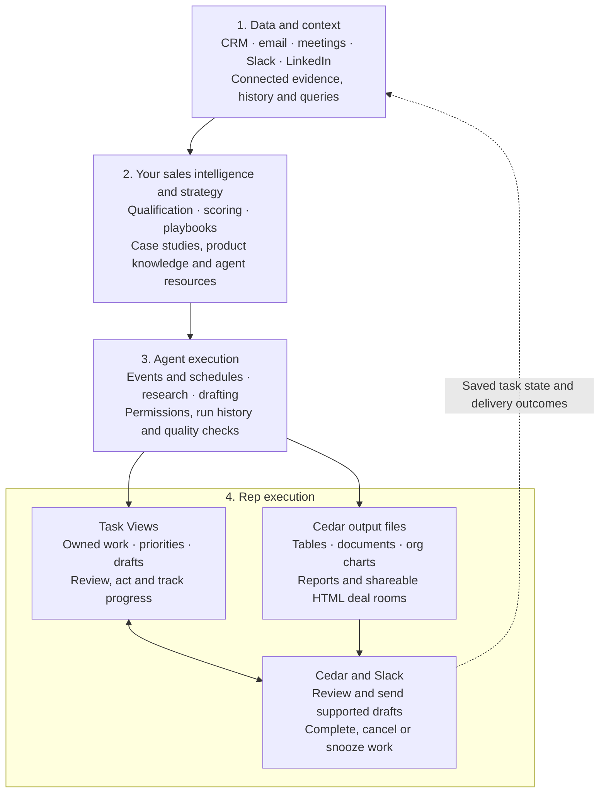

A useful GTM automation connects context, your sales strategy, agent execution and the way reps use the result. Task Views make the last layer actionable: they organize owned work and its outputs so reps can review, act and track what happened.

## 1. Data and context

Connect the channels and CRM records relevant to the workflow. Preserve the original evidence and its source so later research, scoring and recommendations can be checked. Use supported queries and exports to work with the underlying data; access and coverage remain account-specific.

[Channels](/channels/overview) · [Brain data layer](/brain/overview) · [SQL](/channels/sql)

## 2. Your sales intelligence and strategy

Define what matters for your sales motion: qualification, account fit, buying signals, opportunity stages and the next useful action. Give the agent your playbook, case studies, product information and examples. Persist instructions and resources so future runs can use them.

[Playbooks](/automation/playbooks) · [Knowledge base](/knowledge/overview) · [Fields](/configuration/fields)

## 3. Agent execution

Choose when the agent runs, which evidence it can access and which tools it may use. Combine events or schedules with research and drafting, then inspect actual runs and outputs. A successful run is separate from a rep approving an action or a provider confirming delivery.

[Triggers](/agent-platform/triggers) · [Research](/modules/research) · [Execution visibility](/agent-platform/observability)

## 4. Rep execution

Use a **Task View** when the output is work someone owns and needs to act on. Use an **output file** when the result is something to read, reuse or share. A workflow can produce both: a researched account table or deal room alongside the follow-up tasks that put it to use.

Configured Slack task cards let reps review supported drafts and manage the same underlying tasks from Slack. Completed and cancelled task states are reflected on the card; a separate copied checklist is unnecessary.

[Task Views](/tasks/task-views) · [Cedar output files](/agent-platform/specialized-documents) · [Work from Slack](/slack/task-views)

## Examples

| Workflow | Context and strategy | Agent work | Rep experience |
| --- | --- | --- | --- |
| Account prioritization | Usage, engagement, conversations and your account-scoring rules | Maintain evidence-backed account research and priorities | Account table or brief plus owned follow-up tasks in a Task View |
| Slack signal monitoring | Authorized channel activity and your buying-signal/friction definitions | Inspect relevant messages and prepare a supported next step | A task with linked evidence, reviewed from Cedar or Slack |
| Pipeline revival | Deal history, relevant case studies and product updates | Draft a specific, useful reason to reconnect | Review the draft, send deliberately and track the resulting task state |

These are workflow designs, not a promise that a template connects every source or activates every trigger automatically. Start by configuring and testing one workflow and its rep-facing destination.
