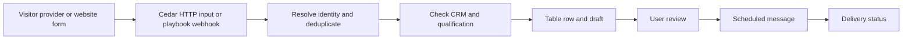

## Architecture

The visitor/form producer and HTTP input setup are separate from MCP. The external MCP provides the context and review/action layer around them.

## Event contract

Include a stable event ID, source URL, event time, and only the identity fields you actually know. For RB2B, use its supported payload fields and the Cedar adapter mapping. For your own form, retain the submitted identity and explicit request rather than attempting to infer an anonymous visitor.

Treat the provider's captured timestamp as event time. Cedar's ingestion time can differ. Deduplicate by a stable source/event key and track previous person-level decisions separately so multiple visits do not produce repeated drafts or messages.

## Qualification rules

Check company fit, role, existing customer/prospect status, active conversations, recent outreach, and whether the source conveys an explicit request or only passive activity. Preserve unknowns and avoid assigning a visit to a namesake.

Use Fiber for manual enrichment when authorized. If enrichment or billing is unavailable, retain an unresolved review row rather than silently switching providers or fabricating qualification.

## Output policy

A background playbook can prepare a row, task, draft, or internal alert. Configure one notification per meaningful new decision or a digest window; no universal cooldown is installed merely by registering a webhook.

The external client can present the review set and schedule explicitly approved messages at distinct times. A repeat visit should update evidence on the existing review record, not create a fresh send authorization.

## Verification

Send one controlled event through the configured source. Confirm that it reaches the intended input/playbook, creates one expected review artifact, preserves the source link, and produces only the intended notification. A webhook acceptance response proves receipt/queueing, not the downstream result. Inspect execution and artifact state before enabling a broader source.
